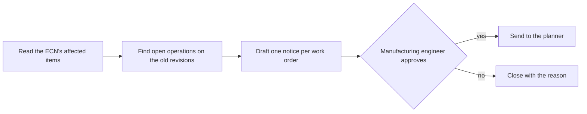

## TL;DR

A workflow is the part of an agent system you refuse to leave to the model. Agent Framework's
workflows "define explicit, inspectable execution paths for coordinating code, agents, state,
events, and human input". There are two ways to write one, a functional API and a graph API, "over
the same workflow run model". On top sit the production behaviours: a pause for a person,
checkpoints, traces, and five prebuilt multi-agent orchestrations. The path is yours. What a model
says at each step still is not.

## Why it matters

{{topic:maf}} ended on a test: an agent for open-ended work, a workflow when the process "has
well-defined steps" and you "need explicit control over execution order". {{topic:multiagent}} made
the same point from the other side. Three of its five patterns share a loop as their documented
failure, and its first question is whether one agent is enough.

A workflow is what you build once the answer is no and the order matters. It matters most when a
step must wait for a person, because a wait that outlasts a process is a durability problem, and
instructions cannot solve those. {{topic:declarative}} quoted the principle from the other route:
instructions "aren't a substitute for application logic that must enforce a transaction, exact
execution order, or recovery procedure."

## How it works

### Two APIs, one run model

"All SDKs support graph-based workflows. Python additionally provides an experimental functional
workflow API." The concepts page says both "produce the same observable workflow results" and
compares them row by row.

| | Functional (`@workflow`) | Graph (`WorkflowBuilder`) |
|---|---|---|
| Control flow | Native Python: `if`, loops, `asyncio.gather` | Edges and conditions |
| Best for | "Sequential pipelines, custom loops, and ad-hoc parallelism" | "Fixed graphs, fan-out/fan-in, and type-validated message routing" |
| Human-in-the-loop | `ctx.request_info()` | `RequestInfoExecutor` |
| Checkpointing | "Per-`@step` result caching" | "Superstep-boundary checkpoints" |
| As an agent | `.as_agent()` on the workflow | `.as_agent()` on the workflow |

The functional API reads like the Python you would have written anyway. The graph API makes the
topology a value the framework can validate, draw and checkpoint. The word *experimental* belongs
in the decision: it is attached to the functional API only, and the graph API is the one every SDK
shares.

### The graph's four parts

The graph model has four primitives, each defined in one line.

- **Executors** "receive inputs, perform work, and emit outputs". An executor can be a function of
  yours or an agent. The Agent Executor "integrates agents into workflow graphs".
- **Edges** "route values between executors", with conditions and fan-out or fan-in groups.
- **Events** "expose workflow lifecycle and execution activity". They are how you watch a run.
- **State** "controls durable and run-scoped workflow state".

The same page adds that a sub-workflow "composes workflows as executors in larger graphs", so a
graph can be reused as one step of another.

### What the capabilities add

The capabilities page describes "production behaviors and reusable patterns" for either API. Each
gets one line there, and those lines are all this lesson can cite.

| Capability | What the page says it does |
|---|---|
| Agents in workflows | "Use agents as workflow participants and executors" |
| Workflows as agents | "Expose a workflow through the standard agent interface" |
| Declarative workflows | "Define supported workflows through declarative configuration" |
| Human-in-the-loop | "Pause for external input and resume execution" |
| Checkpoints and resuming | "Save and restore workflow progress" |
| Observability | "Export workflow spans, metrics, events, and delivery status" |
| Visualization | "Render and export workflow topology" |

*Workflows as agents* is the quiet one. A whole graph can sit behind the interface a single agent
has, so a caller that holds an agent need not know it holds a workflow.

<!-- unknown since=2026-11 -->
Neither page defines a *superstep*, though checkpoints are tied to its boundary. So these pages do
not tell you how much work is repeated when a run resumes, or where a checkpoint is stored. They
also do not say which workflows count as "supported" for declarative configuration. Read the
checkpoint and declarative pages before you design around either. {{topic:foundryagents}} adds one
fact: a hosted agent's state store can hold framework checkpoints.
<!-- /unknown -->

### Orchestrations are prebuilt workflows

The last capability is a set of patterns: "sequential, concurrent, handoff, group-chat, and Magentic
patterns for coordinating agents". They are the five from {{topic:multiagent}} under the same names,
shipped as code. That lesson's warnings travel with them. A prebuilt handoff is still a handoff, and
it still needs a rule for who may finish.

## In practice at Technik

The capstone has no workflow, and that is the first worked example. One agent with three read-only
tools answers its questions in a few calls. Nothing in it has a fixed order worth enforcing.

The second example is a process Technik does have. When an ECN is released, some open work orders
are left on superseded revisions. After `ECN70000051`, work order `100004510` still references
drawing `DU700001042` revision B, and `100004513` still references CNC program `T7000000217`
revision A. A sweep that catches this has well-defined steps.

Go through it with the test from {{topic:maf}}. The first two steps are queries, so they are
functions. The join that finds `100004510` is the one {{topic:multiagent}} refused to split across
agents, and here it does not involve an agent at all. Only the third step needs a model, to turn
rows into a notice a planner can act on. The fourth is a person. The assistant will not write to
SAP or Teamcenter, so the output is a notice and never a change.

That makes it a fixed graph with one fan-out, over the work orders, and one pause. Technik would
write it on the graph API for two reasons. The topology is fixed, which is what that API is "best
for". And the functional API is experimental, which is a poor base for a process that must still run
after the next upgrade. The pause is why the checkpoint matters. An approval requested near the end
of a shift may be answered the next morning, by which time the process that asked may be gone.

Before building any of it, Technik would ask the question from {{topic:lowvspro}}. A flow with an
approval step has the same shape in Copilot Studio ({{topic:agentflows}}, {{topic:approvals}}).
Code wins only if a requirement exceeds that route. Here the candidate is testing: a graph in the
capstone's repository runs under the same offline tests and the same read-only identity.

## Design guidance

- **Use a workflow for order, not for intelligence.** If no step order needs enforcing, it is an
  agent.
- **Make every step that can be a function a function.** Count the model calls and justify each.
- **Choose the graph API for anything that must last.** Keep the experimental API for experiments.
- **Design the pause first.** Decide who answers, how long it may take, and what happens when nobody
  does ({{topic:hitl}}).
- **Bound every loop.** A prebuilt orchestration inherits its pattern's documented failure.
- **Expose it as an agent** when callers should not care how the answer is produced.

## Pitfalls

| Symptom | Cause | Fix |
|---|---|---|
| A workflow breaks after a package upgrade | Built on the experimental functional API | Move durable processes to the graph API |
| An approval is lost when the process restarts | The wait lived in memory, with no checkpoint | Checkpoint before the pause, and test a resume |
| A resumed run repeats work | Checkpoints fall on superstep boundaries, which these pages do not define | Make every step safe to run twice |
| Costs rise with no gain in quality | Steps that are queries were written as agents | Turn them into functions |
| Two agents pass work back and forth | A handoff orchestration with no termination rule | Add an iteration cap ({{topic:multiagent}}) |
| Nobody can say what the workflow does | The topology exists only in code | Render it with the visualization capability |

## Key terms

**Workflow** — an explicit execution path that coordinates code, agents, state, events and human
input.

**Executor** — a unit of a graph workflow that receives inputs, does work and emits outputs. It can
be a function or an agent.

**Edge** — the route a value takes between executors, optionally with a condition.

**Checkpoint** — saved workflow progress that a later run can resume from.

**Orchestration** — a prebuilt multi-agent workflow pattern: sequential, concurrent, handoff, group
chat or Magentic.
